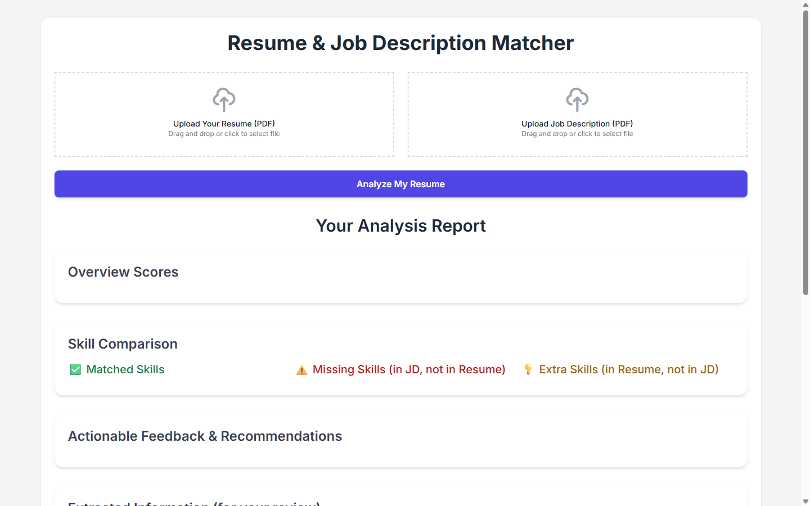
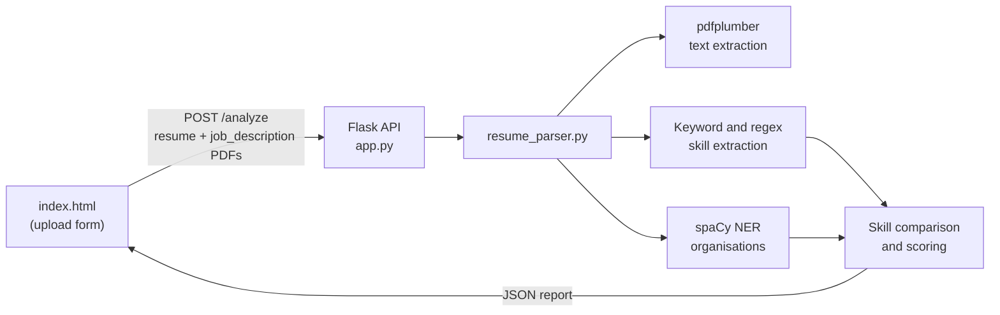

<div align="center">

# Resume & Job Description Matcher

**Upload a resume and a job description; get matched, missing and extra skills, three fit scores and targeted recommendations.**

[](LICENSE)
[](https://www.python.org)
[](https://flask.palletsprojects.com)
[](https://spacy.io)
[](https://tailwindcss.com)

[Report a bug](https://github.com/Divyakush2006/Project--Resume-checker-and-anhancer-using-machine-learning-/issues/new/choose) · [Request a feature](https://github.com/Divyakush2006/Project--Resume-checker-and-anhancer-using-machine-learning-/issues/new/choose)



</div>

## Overview

A web application that helps job seekers tailor a resume to a specific role. It extracts text from both PDFs, identifies skills, education and organisations with keyword matching and spaCy named-entity recognition, compares the resume against the job description, and returns a report with scores and concrete next steps.

## Features

- **PDF upload:** drag and drop a resume and a job description.
- **Skill comparison:** every skill is sorted into one of three groups:
  - **Matched**: in both the resume and the job description
  - **Missing**: required by the job description but absent from the resume
  - **Extra**: in the resume but not asked for
- **Three scores:**

  | Score | How it is calculated |
  | --- | --- |
  | Overall skill match | Share of job-description skills found in the resume |
  | Recruiter readiness | 70% skill match, plus bonuses when education (+10) and organisations (+20) are found, capped at 100 |
  | Resume completeness | Whether skills, education and organisations were each extracted (one third each) |

- **Actionable feedback:** personalised suggestions to close the gap with the role.
- **Extracted information:** the education and organisations parsed from the resume, shown for review.
- **Salary guidance:** pointers to credible external sources, since salaries cannot be estimated reliably from a resume.

## How it works



Uploaded files are written to a temporary directory for processing and removed afterwards.

## Tech stack

| Layer | Technology |
| --- | --- |
| Frontend | HTML5, Tailwind CSS, vanilla JavaScript |
| Backend | Python, Flask, Flask-CORS |
| Document parsing | pdfplumber |
| NLP | spaCy (`en_core_web_sm`), regular expressions |

## Getting started

### Prerequisites

- Python 3.8 or later
- Git

### Installation

```bash
git clone https://github.com/Divyakush2006/Project--Resume-checker-and-anhancer-using-machine-learning-.git
cd Project--Resume-checker-and-anhancer-using-machine-learning-

python -m venv venv
source venv/bin/activate          # Windows: venv\Scripts\activate

pip install -r requirements.txt
python -m spacy download en_core_web_sm
```

### Run

```bash
python app.py                     # API on http://127.0.0.1:5000
```

Then open `index.html` in your browser. The page sends files to `http://127.0.0.1:5000/analyze`, so keep the Flask server running.

### Usage

1. Upload your resume (PDF) in the left panel.
2. Upload the job description (PDF) in the right panel.
3. Select **Analyze My Resume** to see the scores, skill comparison and recommendations.

## API

| Method | Endpoint | Body | Description |
| --- | --- | --- | --- |
| `GET` | `/` | none | Welcome message (service check) |
| `POST` | `/analyze` | `multipart/form-data` with `resume` and `job_description` PDF files | Returns the analysis report as JSON |

## Project structure

```
.
├── app.py              # Flask app: upload handling and the /analyze endpoint
├── resume_parser.py    # PDF parsing, skill extraction, comparison, scoring and feedback
├── index.html          # Single-page user interface
├── requirements.txt    # Python dependencies
└── vercel.json         # Serverless routing configuration
```

## Disclaimer

The analysis is automated guidance. Review every suggestion before changing your resume, and research salary expectations with current, credible industry sources.

## Contributing

Contributions are welcome. Please read the [contributing guide](https://github.com/Divyakush2006/.github/blob/main/CONTRIBUTING.md) before opening a pull request.

## Security

Please report vulnerabilities privately as described in the [security policy](https://github.com/Divyakush2006/.github/blob/main/SECURITY.md). Do not open a public issue.

## License

Released under the [MIT License](LICENSE).

## Author

**Divyakush Punjabi** · [www.divyakush.com](https://www.divyakush.com) · [GitHub](https://github.com/Divyakush2006) · [LinkedIn](https://linkedin.com/in/divyakush-punjabi)
